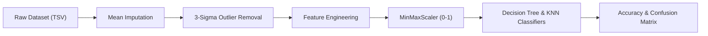

# 🎓 Student Performance & Screen-Time Predictor (ML Pipeline)


An end-to-end **Machine Learning & Data Engineering pipeline** in Python that cleans student behavioral and academic telemetry, performs domain-specific feature extraction, filters extreme outliers via the **3-Sigma Rule**, and trains **Decision Tree** and **K-Nearest Neighbors (KNN)** classifiers.

---

## 🔄 End-to-End ML Pipeline



---

## ✨ Key Features

- **Automated Data Sanitization:** Handles missing observations via column-wise mean imputation and eliminates anomalies exceeding $\mu \pm 3\sigma$.
- **Domain Feature Engineering:** Constructs composite behavioral indicators:
  - `Performans_Skoru` — Weighted academic achievement index
  - `Yorgunluk_Indeksi` — Composite fatigue metric combining screen exposure, sleep deprivation, and social isolation
  - `Fazla_Ekran` — Binary classification target for excessive daily screen time
- **Feature Scaling:** Applies `MinMaxScaler` across continuous predictors to preserve Euclidean distance integrity for KNN.
- **Dual-Model Benchmarking:** Trains and compares **Decision Tree (`DecisionTreeClassifier`)** and **K-Nearest Neighbors (`KNeighborsClassifier`)** with full classification reports.

---

## 🗂️ Project Structure

```text
Student-Performance-Predictor/
├── data/
│   └── raw_data.tsv         # Raw student academic & lifestyle telemetry
├── src/
│   └── main.py              # Preprocessing, feature engineering & ML training pipeline
├── requirements.txt         # Python dependencies
├── LICENSE                  # MIT License
└── README.md                # Project documentation
```

---

## 🚀 Getting Started

```bash
git clone https://github.com/Firatdondar/Student-Performance-Predictor.git
cd Student-Performance-Predictor
pip install -r requirements.txt
python src/main.py
```

---

## 📄 License

Distributed under the **MIT License**. See [`LICENSE`](LICENSE) for details.
